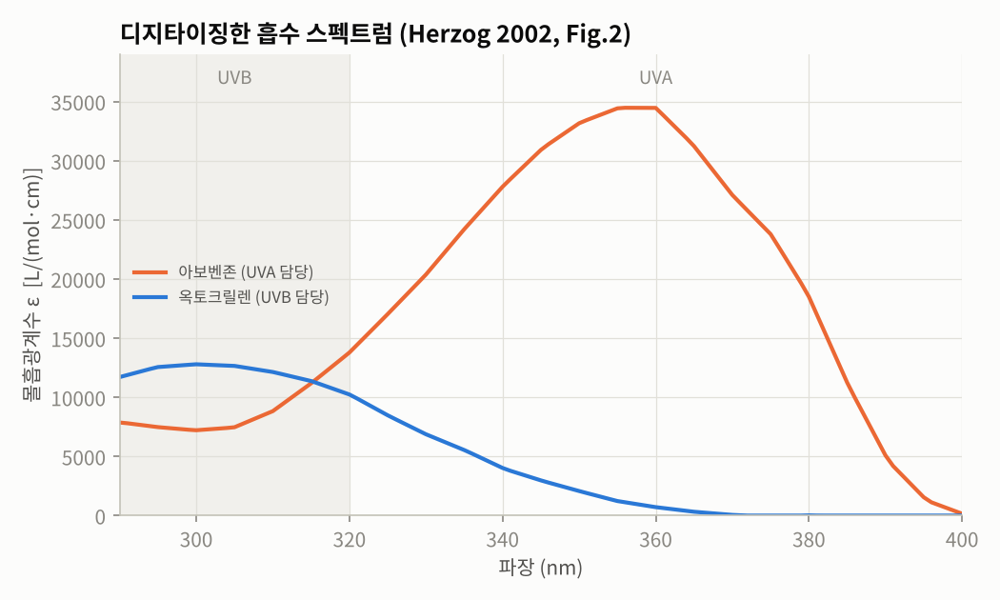
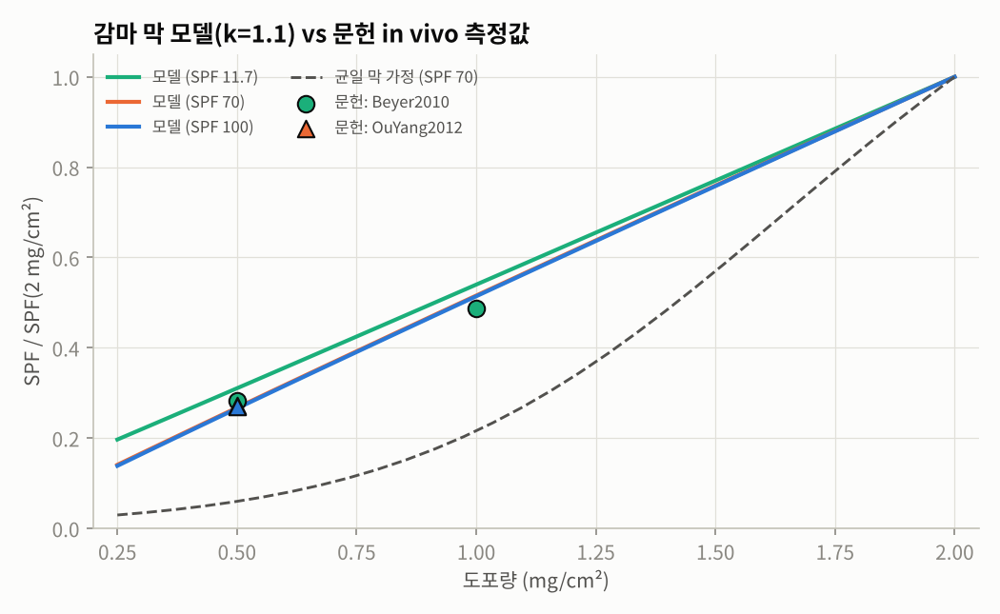
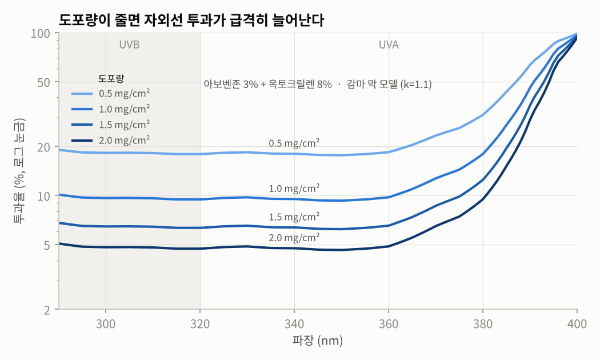
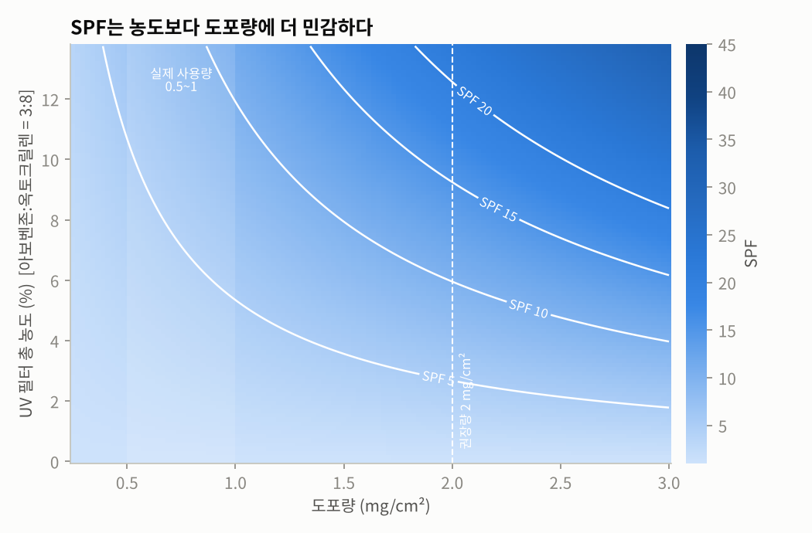
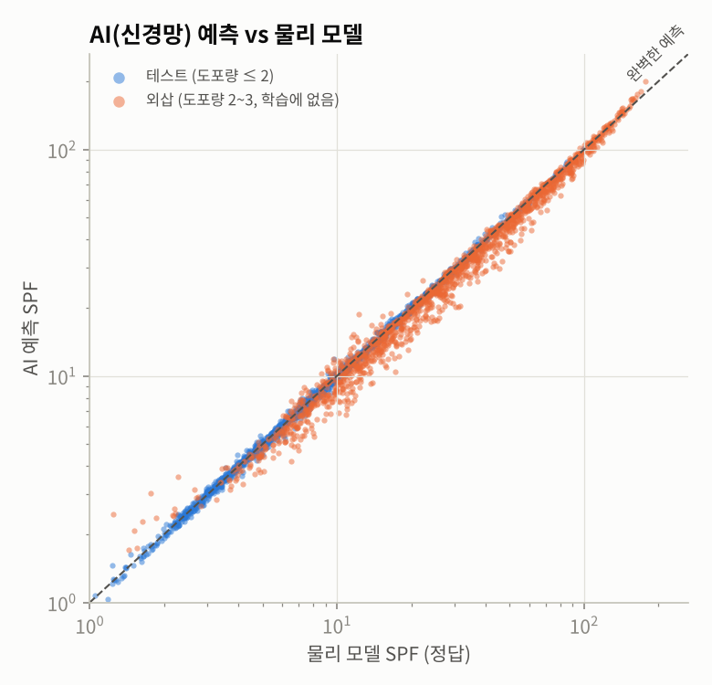
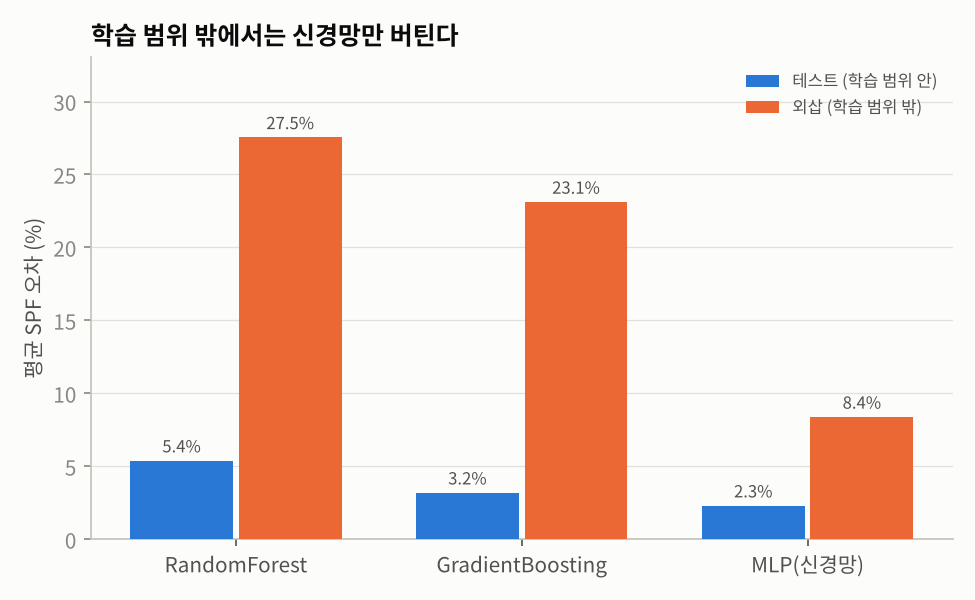

# 자외선 차단제 도포 두께·농도에 따른 UV 투과율 분석

Beer-Lambert 법칙 기반 물리 모델과 AI 대리 모델(surrogate)을 이용해 자외선 차단제의 도포량과 성분 농도가 UV 투과율과 SPF에 미치는 영향을 분석합니다.

## 주요 결과

- 막이 균일하다고 가정한 순수 Beer-Lambert 모델은 SPF를 크게 과대평가함 (아보벤존 3% + 옥토크릴렌 8%, 2 mg/cm²에서 SPF 162)
- 막 두께를 감마 분포로 둔 불균일 막 모델에서 불균일도 k를 문헌 in vivo 측정값 4개 지점에 보정 → k = 1.1 (로그 RMS 오차 0.071), 같은 처방의 SPF 17.6
- AI 대리 모델 중 신경망(MLP)이 가장 정확 (테스트 오차 2.3%, 학습 범위 밖 외삽 오차 8.4%)
- 변수 중요도: 도포량 > 막 불균일도 > 성분 농도
- 역설계: 두 성분을 국내 사용한도(5% + 10%)까지 넣어도 최대 SPF는 2 mg/cm²에서 24.8, 1 mg/cm²에서 12.9

## 결과 그래프

모든 그래프는 `figures.py`로 생성했습니다 (Google Colab에서 실행).

### 1. 디지타이징한 흡수 스펙트럼
Herzog (2002) Fig.2를 WebPlotDigitizer로 직접 추출. 아보벤존 피크 ε ≈ 34,480 (문헌 환산값 34,143~36,005 범위 안).



### 2. 막 불균일 모델 보정
막이 균일하다는 가정(점선)은 도포량 감소에 따른 SPF 하락을 과장함. 감마 분포 막 모델(k = 1.1)은 문헌 in vivo 측정값과 일치.



### 3. 도포량별 투과율 스펙트럼
도포량이 줄면 UVB·UVA 투과율이 모두 크게 증가함.



### 4. 도포량 × 농도 SPF 히트맵
SPF 등고선이 눕혀져 있음 → 농도를 올리는 것보다 도포량을 늘리는 것이 SPF에 더 효과적.



### 5. AI 예측 vs 물리 모델
신경망 예측이 물리 모델 값과 거의 일치. 학습 범위 밖(외삽)에서는 오차가 조금 커짐.



### 6. 모델별 오차 비교
학습 범위 밖에서는 트리 계열 모델(23~28%)보다 신경망(8.4%)이 훨씬 안정적.



## 사용 성분

| 성분 | 담당 영역 | 최대 흡수 | 국내 사용한도 |
|---|---|---|---|
| 아보벤존 (부틸메톡시디벤조일메탄) | UVA | 약 357 nm | 5% |
| 옥토크릴렌 | UVB | 약 300 nm | 10% |

선정 기준: ① 흡수형 성분이라 Beer-Lambert 적용 가능 ② UVB와 UVA를 나눠 담당 ③ 같은 논문·같은 용매(에탄올) 스펙트럼 확보 가능 ④ 국내 허용 성분

## 폴더 구조

```
sunscreen_sim/
├── data/
│   ├── raw/                     # WebPlotDigitizer로 직접 추출한 원본
│   ├── epsilon_digitized.csv    # 1 nm 간격으로 정리한 몰흡광계수
│   └── eps_herzog2002_fig2.csv  # 검증용 독립 판독값
├── prepare_data.py   # 원본 정리 + 디지타이징 오차 검증
├── physics.py        # Beer-Lambert, 막 모델, SPF 계산
├── calibrate.py      # 막 모델 파라미터를 문헌 in vivo 데이터에 보정
├── ai_surrogate.py   # 학습 데이터 생성, 모델 비교, 변수 중요도, 역설계
└── figures.py        # 보고서용 그래프 6종
```

## 실행 방법 (Google Colab)

1. 이 저장소 페이지에서 **Code → Download ZIP**으로 zip을 받습니다.
2. 코랩에서 새 노트를 열고, 왼쪽 폴더 아이콘으로 zip을 업로드합니다.
3. 첫 번째 셀: 압축 풀고 폴더로 이동
```
!rm -rf /content/sunscreen-uv-simulation-main
!unzip -o -q "$(ls -t $(find / -name 'sunscreen-uv-simulation-main*.zip' -not -path '/proc/*' 2>/dev/null) | head -1)" -d /content
%cd /content/sunscreen-uv-simulation-main
```
4. 두 번째 셀: 설치와 실행
```
!apt-get -qq install fonts-nanum > /dev/null
!pip install -r requirements.txt -q
!python prepare_data.py
!python physics.py
!python calibrate.py
!python ai_surrogate.py
%run figures.py
```
그래프 한글이 네모로 나오면 **런타임 → 세션 다시 시작** 후 첫 번째 셀과 `%run figures.py`만 다시 실행합니다.
## 모델 요약

- 흡광도: A(λ) = Σ εᵢ(λ) · cᵢ · l
- 불균일 막 투과율 (감마 분포, 평균 두께 정규화): T(λ) = (1 + A(λ)·ln10 / k)^(−k)
- SPF = ∫E(λ)S(λ)dλ / ∫E(λ)S(λ)T(λ)dλ
  - E: CIE 1998 홍반 작용 스펙트럼, S: ASTM G173-03 태양 스펙트럼 (pvlib)

## 데이터 출처

- 흡수 스펙트럼: Herzog B. (2002), *J. Cosmet. Sci.* 53:11-26, Fig.2 (에탄올) — WebPlotDigitizer로 추출
- 막 불균일 모델 아이디어: Ferrero L. et al. (2003), *J. Cosmet. Sci.* 54:463-481 — 막 두께를 감마 분포로 두는 개념만 참고했고, 불균일도 k는 본 프로젝트에서 직접 보정함
- 막 모델 보정용 in vivo 데이터
  - Beyer D.M., Faurschou A., Haedersdal M., Wulf H.C. (2010). Clothing reduces the sun protection factor of sunscreens. *Br J Dermatol* 162(2):415-419. doi:10.1111/j.1365-2133.2009.09478.x — 옷을 입지 않은 피부의 중앙값 SPF 사용
  - Ou-Yang H., Stanfield J., Cole C., Appa Y., Rigel D. (2012). High-SPF sunscreens (SPF ≥ 70) may provide ultraviolet protection above minimal recommended levels by adequately compensating for lower sunscreen user application amounts. *J Am Acad Dermatol* 67(6):1220-1227. doi:10.1016/j.jaad.2012.02.029
- 사용한도: 식품의약품안전처 「화장품 안전기준 등에 관한 규정」 별표 2 (일부개정고시 제2025-63호, 2025.9.2)

## 한계

- 용매(에탄올)에서 측정한 스펙트럼을 실제 제형(오일·에멀전)에 그대로 적용함
- 광분해(아보벤존), 옥토크릴렌의 광안정화 효과, 산란은 고려하지 않음
- 보정에 사용한 문헌 데이터는 성분 구성이 다른 제품들에서 측정됨 (총 4개 지점)
- Ou-Yang et al. (2012)의 저자 일부는 시험 제품 제조사(Neutrogena) 소속으로, 이해충돌이 있음
- 2차 출처(기업 블로그)로만 확인되는 독일 링테스트 값은 보정에서 제외함
